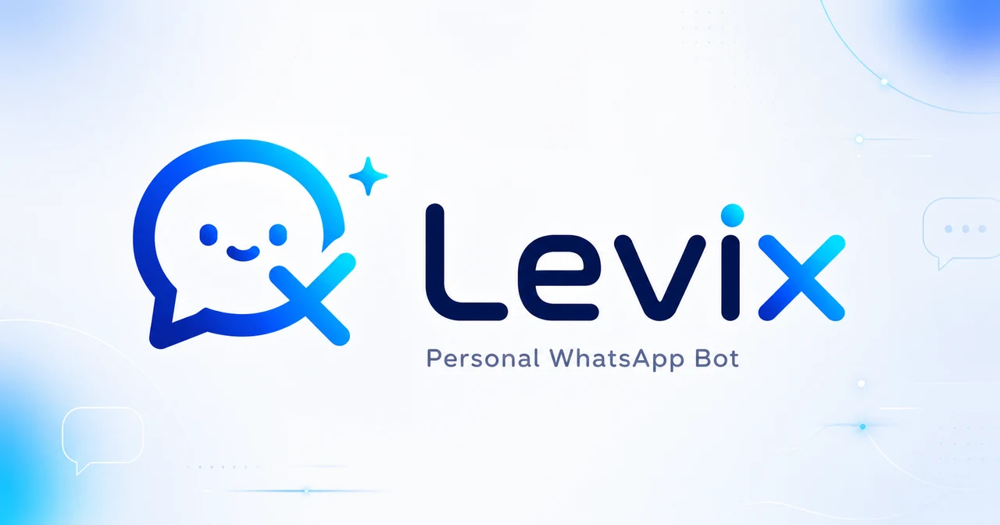

<p align="center">
  
</p>

<p align="center">
  <a href="https://github.com/Abdodiab2005/levix/actions/workflows/ci.yml"></a>
  <a href="https://www.npmjs.com/package/levix-bot"></a>
  <a href="LICENSE"></a>
  
</p>

<p align="center">
  <strong>Free, open-source, self-hosted WhatsApp automation that stays under your control.</strong>
</p>

<p align="center">
  <a href="https://levix.leviro.net">Website</a> ·
  <a href="SETUP.md">Setup guide</a> ·
  <a href="https://levix.leviro.net/docs/contributing">Contribute</a> ·
  <a href="https://github.com/Abdodiab2005/levix/releases/latest">Downloads</a> ·
  <a href="https://github.com/Abdodiab2005/levix/issues">Issues</a>
</p>

Levix is a personal WhatsApp bot with a growing command catalog, group moderation, scheduled
messages, an AI agent, media tools, and a web control panel. You run it on your
own computer or server, keep its database and session files yourself, and can
change almost everything while it is running.

There is no paid tier, hosted account, external database, or configuration file
to maintain. Levix is released under the MIT License.

> [!WARNING]
> Levix uses [Baileys](https://github.com/WhiskeySockets/Baileys), an unofficial
> WhatsApp Web client, and is not affiliated with or endorsed by WhatsApp or
> Meta. Unofficial automation can lead to temporary restrictions or an account
> ban. Do not use Levix for spam or unsolicited bulk messaging. If an outage or
> account restriction is unacceptable, use the official WhatsApp Business
> Platform instead.

## Quick start

### Linux server

The public installer installs the latest stable release and configures Levix as
a service:

```bash
curl -fsSL https://levix.leviro.net/install.sh | bash
```

You can [read the installer](deploy/install.sh) before running it.

### npm

Requires Node.js 24 or newer:

```bash
npm install -g levix-bot
levix
```

### Docker

```bash
git clone https://github.com/Abdodiab2005/levix
cd levix
docker compose up -d
docker compose logs levix
```

### Android phone (No server required)

Run Levix directly on an Android device (Android 10+, ARM64 or ARMv7) as a self-contained background companion:

1. Download **`levix-android-arm64.apk`** (64-bit phones) or **`levix-android-armv7.apk`** (32-bit phones) from [Releases](https://github.com/Abdodiab2005/levix/releases).
2. Install the APK and tap **Start Assistant** — the big circle on the home screen.
3. Tap **Connect WhatsApp** to set your panel password and link WhatsApp via an 8-character pairing code.

See [ANDROID.md](ANDROID.md) for full instructions, OEM battery optimizations (Xiaomi, Samsung, OnePlus), and offline handling.

---

Standalone Linux, macOS ARM64, and Windows binaries are available from the
[latest GitHub release](https://github.com/Abdodiab2005/levix/releases/latest).

When Levix starts:

1. Open the panel URL printed in the terminal.
2. Choose a panel password. A remote first-time setup also asks for the printed
   setup code.
3. Open **Connection**, press **Start session**, and scan the QR from WhatsApp.
4. Send `!ping` in a chat.

A successfully linked WhatsApp session resumes automatically after a process,
Docker, or systemd restart. See [SETUP.md](SETUP.md) for domains, reverse
proxies, headless mode, backups, and troubleshooting.

## What you get

| Area | What Levix provides |
| --- | --- |
| Commands | Utilities, notes, reminders, polls, media, speech, weather, prayer times, and more — configurable from the panel |
| Translation | `!translate` between Arabic and English, or into a language you name, with your active AI provider or Google translation (the official API with a key, or Google's public endpoint without one), plus summary, tone, explain, and detect options |
| Group moderation | Welcome messages, anti-link, anti-spam, media rules, and forbidden words in one linked pipeline with a shared warning counter per member — at the limit the group removes the member automatically or flags them for admin review, guided by a per-group policy (Relaxed / Standard / Strict presets, warning limit, per-feature actions, warning expiry); warnings, roles, rules, and notes too |
| AI agent | Pick Google Gemini, OpenAI / any OpenAI-compatible server, or Anthropic from the panel; each provider has its own endpoint, API key, and model, with tools for web search, page reading, memory, and role management |
| Scheduling | One-off, daily, and weekly messages with durable jobs, delivery status, and manual retry |
| Control panel | Live connection state, command settings, roles, permissions, keys, memory, schedules, and logs |
| Media | Text, images, video, audio, QR codes, text-to-speech, and speech-to-text |
| Stickers | Turn a photo, GIF, or short video into a sticker, and keep a personal library and packs from chat or the panel |
| Deployment | Android APK, npm, Docker, systemd installer, standalone binaries, headless mode, and safe domain setup |
| Storage | One SQLite database and one data directory for settings, sessions, memory, and logs |

Every command can be enabled, disabled, renamed, and assigned permissions from
the panel without restarting the bot.

### AI that can act

The `!gemini` command is an agent rather than a plain chat box. It can run
several tool rounds, search the web, read a page, save long-term memories, and
manage bot roles. It narrates progress by editing one WhatsApp message and lists
sources when it uses web search.

AI answers are formatted for WhatsApp automatically: `**bold**` becomes `*bold*`,
`__italic__` becomes `_italic_`, and tables become named entries with labeled
bullet points. Headings, lists, checkboxes, strikethrough and links are converted;
code contents and URLs are preserved.

Replies follow the language and dialect you write in — Egyptian Arabic in,
Egyptian Arabic out.

Use `!md` (or `!markdown`) to convert text from any other AI or message, without
an AI key. Reply to that message with `!md`, or paste Markdown after the command,
including multiline tables and code. For example: `!md **Bold** and __italic__`.
Existing WhatsApp `*bold*` and `_italic_` text keeps its formatting.

AI is optional. The rest of Levix works without an AI key.

#### Ask about Levix or request media

Ask `!ai How do I back up Levix?` for help grounded in this release's bundled
README, setup, Android, privacy and four-language command reference. The AI can
search those documents offline and cite the source section and version. Prose
guides are English; Arabic, Brazilian Portuguese and Latin American Spanish
queries can fall back to them. Missing evidence is reported instead of treating
future plans as installed features. Only the retrieval is offline: an AI answer
still uses your configured chat provider.

- `!ai Create an image of a cat on the moon` uses the same dedicated Gemini
  image key and model as `!generate`.
- Reply to text with `!ai Read this aloud` for Google TTS, the same synthesizer
  as `!tts`. FFmpeg makes a voice note; MP3 is the fallback.
- Reply to a voice message with `!ai Transcribe this voice note` for the same
  Gemini/OpenAI-compatible transcription policy as `!stt`. The transcript then
  becomes context for the selected chat provider's answer.

These actions retain the backing command's live permission and enabled state,
and results follow the configured reply router. They do not change your chat
provider. Image and transcription providers may charge against your own key;
Google TTS has no API-key charge. There is no music or sound-effect generator.
Natural-language media tools have bounded input, output, time and request rates;
a missing key, unsupported response or refused delivery is a failure.

### Persistent schedules and memory

One-off and recurring schedules survive restarts and record their latest
delivery outcome. Long-term memory is stored as plain Markdown in
`memory/global.md` or per-chat files, so it remains readable and editable
outside the panel.

### A connection you control

The panel can start, stop, reconnect, and unlink WhatsApp while showing the
actual state: idle, waiting for a scan, connected, reconnecting, or stopped.
Reconnect attempts continue inside the bot even when no browser is open.

The Free account card on **Connection** shows your connected WhatsApp profile
picture, display name, verified phone number and About text. Missing or private
details use a neutral placeholder. Open the screen or use its refresh button;
stats polling does not query your profile. Profile lookups and images use a
short memory cache, and disconnecting clears the visible account details.

An optional HTTP, HTTPS, or SOCKS5 proxy can route WhatsApp traffic, including
media, without changing how the panel or AI connects.

## Checking for updates

`!update` checks official release information and replies with the current
version and a release link. It is owner-only by default, with the same command
permission controls as other commands. Stable installations see stable releases;
beta installations can see a newer beta in their release line or a stable
release. An offline check leaves the bot running normally. Checks share a short
local cache and never download or install executable code.

Open **Settings → About Levix** or **Help → About Levix** to check manually,
read release notes, and open the official documentation, support, developer and
Leviro links. Google Play installations check through Play and offer a flexible
update: you choose when to download and when to restart. Other installations
open the official GitHub release so you can use your normal installation method.
Rating and GitHub stars are optional. Play review prompts have a separate local
switch that is off by default; Google controls whether a review card appears.

The optional **Powered by Levix** watermark stays off by default. Its existing
Free switch is retained. When enabled, it excludes exact output, raw transcripts,
forwarded text, short links, files and security messages. Active Plus extensions
can hide it through the existing entitlement-controlled hook.

## CLI

```text
levix                    start Levix with the web panel
levix headless           start Levix with no web UI or open port
levix where              print the data directory
levix reset-password     reset the panel password
levix domain [name]      configure a domain safely (may need sudo)
```

A fresh panel install waits for you to start the first WhatsApp pairing.
`levix headless` has no button to press, so it starts the session itself and
prints the QR in the terminal when needed.

## Data and configuration

Everything mutable lives in one data directory:

- npm installation: `~/.levix`
- source checkout: `./data`
- Docker: the `levix-data` volume

Copying this directory is a full backup, including the SQLite database, WhatsApp
session, memory, and logs.

The database is the source of truth. The prefix, permissions, API keys, server
settings, and feature options are stored in `bot_settings` and read at use
time. There is no `.env` or application configuration file to keep in sync.

Secrets are generated rather than shipped with defaults. The panel password is
stored as an scrypt hash, and the session-signing key is generated on first
start.

## Architecture

- **Node.js 24** with ES modules and CommonJS where needed. A newer Node starts with a warning that it
  is not officially supported.
- **Baileys v7** for the WhatsApp protocol engine, LID support, and phone pairing codes.
- **`node:sqlite`** for a zero-dependency, single-file datastore.
- **React + Vite Control Panel** (`frontend/`) with TypeScript, native RTL Arabic / English internationalization, Lucide icons, responsive drawer, modal dialogs, and real-time Socket.IO synchronization.
- **Express + EJS Gateways** for lightweight setup, login, and pairing QR gateway screens.
- **Pluggable AI providers** — Google Gemini, OpenAI / any OpenAI-compatible endpoint, or
  Anthropic — each with its own endpoint, API key, and model in the control panel, no env file.
- **Biome** for fast formatting and linting across the codebase.
- **GitHub Actions** validation for tests, npm packaging, Docker persistence,
  Android APK packaging, and standalone executables on Linux, macOS, and Windows.

[AGENTS.md](AGENTS.md) documents the module layout, message flow, storage API,
and architectural constraints. [PACKAGING.md](PACKAGING.md) covers npm, Docker,
systemd, installers, and single-executable releases.

## Development

```bash
git clone https://github.com/Abdodiab2005/levix
cd levix
npm ci
cd frontend && npm ci && cd ..
npm run build        # compiles the React frontend to public/dashboard
npm run lint         # runs Biome linter across the project
npm test             # runs the full test suite
npm start            # starts Levix
```

Read the [contributor walkthrough](https://levix.leviro.net/docs/contributing) for the fork-to-pull-request workflow, then check [CONTRIBUTING.md](CONTRIBUTING.md) for the official repository rules. Bug reports and focused pull requests are welcome.

For security issues, follow [SECURITY.md](SECURITY.md) and report them
privately rather than opening a public issue.

## Sending feedback

**Settings → Feedback** in the control panel writes straight to the developer.
The bot forwards it server-side to `levix.leviro.net/api/feedback`, which
delivers it as a Telegram message; the same form is on the web at
[levix.leviro.net/feedback](https://levix.leviro.net/feedback). It carries your
message, the topic, an optional rating, an optional contact and one optional
file you attach (a screenshot or a log, up to 20 MB), plus the version and
platform — and nothing from WhatsApp. Nothing leaves until you press Send.

Prefer a public, trackable bug report with logs attached? Open an
[issue](https://github.com/Abdodiab2005/levix/issues) instead.

## License

Levix is free and open source under the [MIT License](LICENSE).

Built by [Abdelrhman Diab](https://github.com/Abdodiab2005) under
[Leviro](https://leviro.net).
